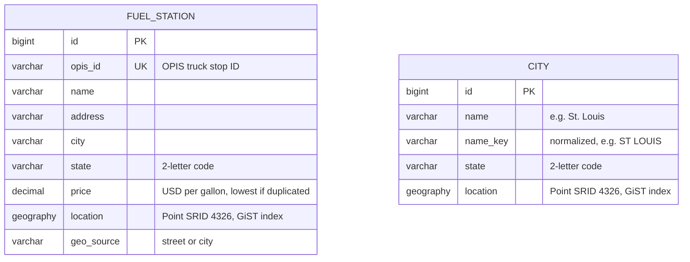

# Fuel Route API

A Django REST API that takes a start and a finish location in the USA and returns:

- the driving route,
- the most cost-effective fuel stops along the way,
- the total fuel cost,
- a link to an interactive map of the trip.

---

## Database (ER diagram)

The two tables have no foreign key on purpose. They are related spatially, not by IDs:

- city resolves the user's input to a point, using the index.
- fuel_station is queried against the route line with spatial functions, using the GiST index on location.

---

## Architecture

### Component diagram

| Component | Responsibility |
| --- | --- |
| `views.py` | Validates input with the serializer, maps errors to HTTP codes, returns JSON or the HTML map |
| `locations.py` | Turns address into coordinates using the local city table |
| `ors_client.py` | Gets the route line, distance and duration from OpenRouteService |
| `corridor.py` | One PostGIS query: stations within N miles of the route, each with its mile marker |
| `optimizer.py` | Pure Python algorithm that picks where to buy fuel and how much |
| `planner.py` | Connects everything and caches routes and results in Redis |

