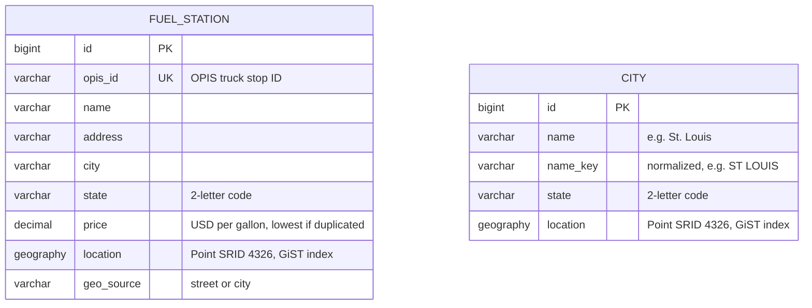
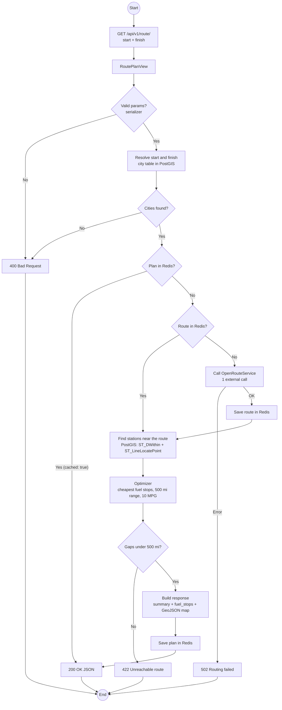
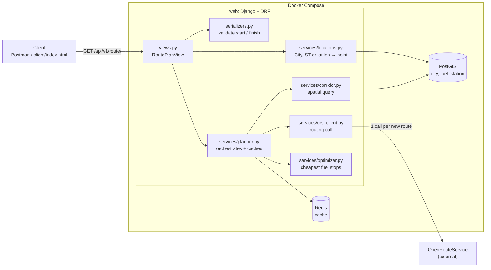
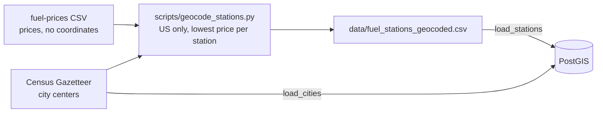

# Fuel Route API

A Django REST API that takes a start and a finish location in the USA and returns:

- the driving route,
- the most cost-effective fuel stops along the way,
- the total fuel cost,
- a link to an interactive map of the trip.

---

## Database (ER diagram)

The two tables have no foreign key on purpose. They are related spatially, not by IDs:

- city resolves the user's input to a point, using the index.
- fuel_station is queried against the route line with spatial functions, using the GiST index on location.

---

## Architecture

### API flow

**Errors:** invalid parameter or unknown city → `400` · gap longer than 500 miles → `422` · routing service failure → `502`.

### Components

| Component | Responsibility |
| --- | --- |
| `views.py` | Validates input, maps errors to HTTP codes, returns JSON |
| `locations.py` | Turns `"Denver, CO"` or `"39.74,-104.99"` into coordinates |
| `planner.py` | Orchestrates the request and caches routes and plans in Redis |
| `ors_client.py` | The only external call: route line, distance and duration |
| `corridor.py` | One PostGIS query: stations within 10 miles of the route, with mile markers |
| `optimizer.py` | Pure Python greedy algorithm: where to buy fuel and how much |

### Offline data preparation (runs once)

The fuel CSV has prices but no coordinates, so stations are placed at their city center once, offline. At request time the API only reads PostGIS, which keeps it fast and limits external calls to one routing call per new route.

